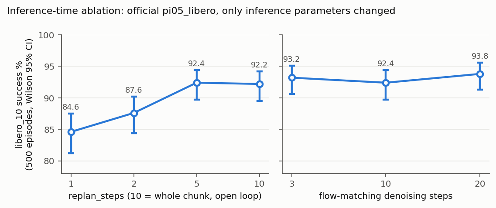
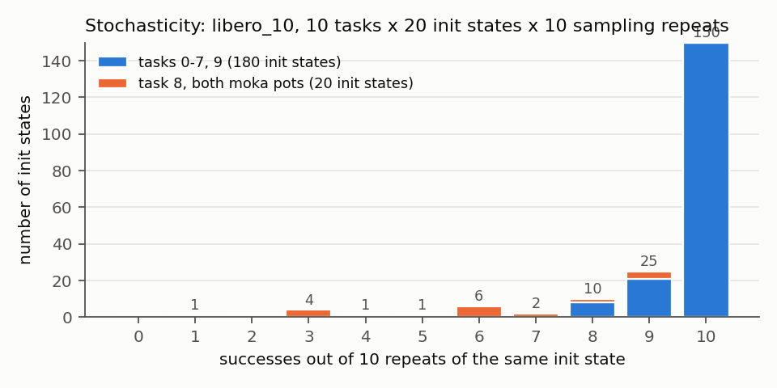

# notes/03 推理期消融与随机性分离：不训练，只改推理，能知道什么

> 读者：lwang。目的：同一个 checkpoint，只改两个推理参数（replan 步数、去噪步数）和重复采样，就能把"失败来自哪里"切开一半。对应计划 §1.3、§1.5。数据：[`results/inference_ablation.csv`](../results/inference_ablation.csv)、[`results/stochasticity_by_init.csv`](../results/stochasticity_by_init.csv)，图 [`results/inference_ablation.png`](../results/inference_ablation.png)、[`results/stochasticity_hist.png`](../results/stochasticity_hist.png)。

## 0. 两个实验各自区分什么

| 实验 | 改什么 | 假设 A | 假设 B |
|---|---|---|---|
| replan 消融 | 每次推理后执行 chunk 的前 k 步再重新观测，k = 1/2/5/10 | 失败来自"预测错"：开环（k=10）和闭环差不多 | 失败来自"不纠偏"：开环大跌 |
| 去噪步数 | flow matching 采样步数 3/10/20 | 动作质量受采样精度限制：步数多更好 | 不受限：没差别 |
| 随机性分离 | 固定初始状态，重复 10 次 | 失败由初始状态决定：每个初始状态全成或全败 | 失败来自采样随机：成功率散在 0–1 之间 |

## 1. 代码在哪

### 1.1 replan：client 端的一个 deque

[`scripts/eval_libero.py:125-157`](../scripts/eval_libero.py#L125)：

```python
if not action_plan:                      # 队列空了才问一次模型
    element = {...}                      # 两张图 + state + prompt
    out = client.infer(element)
    chunk = out["actions"]               # (action_horizon=10, 7)
    assert len(chunk) >= args.replan_steps
    action_plan.extend(chunk[: args.replan_steps])   # 只保留前 k 步
action = action_plan.popleft()
obs, reward, done, info = env.step(action.tolist())
```

模型一次吐 10 步（`pi05_libero` 的 `action_horizon=10`，[`config.py:745`](../external/openpi/src/openpi/training/config.py#L745)），client 只执行前 k 步就丢掉剩下的、重新观测。k=10 就是整段开环；k=1 是每一步都重新推理。openpi 官方 [`main.py`](../external/openpi/examples/libero/main.py) 默认 k=5。**计划里写的 25/50 不存在**：horizon 只有 10，`assert` 会拦住。

### 1.2 去噪步数：server 端的 while_loop

[`scripts/serve_policy_ext.py:21-38`](../scripts/serve_policy_ext.py#L21) 把 `--num-steps` 传进 `sample_kwargs`，最终到 [`pi0.py:217-279`](../external/openpi/src/openpi/models/pi0.py#L217)：

```python
def sample_actions(self, rng, observation, *, num_steps=10, noise=None):
    dt = -1.0 / num_steps                     # t 从 1（噪声）走到 0（动作）
    noise = jax.random.normal(rng, (b, action_horizon, action_dim))
    _, kv_cache = self.PaliGemma.llm([prefix_tokens, None], ...)   # 图+文只算一次
    def step(carry):
        x_t, time = carry
        ...                                   # suffix = 噪声动作 + 时间步，attend 到 prefix 的 kv_cache
        v_t = self.action_out_proj(suffix_out[:, -self.action_horizon:])
        return x_t + dt * v_t, time + dt      # 欧拉一步
    x_0, _ = jax.lax.while_loop(cond, step, (noise, 1.0))
    return x_0
```

三件事值得记住：(a) VLM 前缀只跑一次，去噪步数只影响小的 action expert，所以 3 步 27 ms、10 步 67 ms、20 步 94 ms（见 CSV 的 `infer_ms`）；(b) 随机性只有一个来源：`noise`。每次调用 server 里的 rng 都往前走，所以同一观测两次结果不同；(c) 欧拉步，不是高阶积分器，步数少时理论上会偏。

## 2. 结果

### 2.1 replan × 去噪步数（libero_10，每格 500 集）

| 配置 | 成功 | 成功率 | 95% CI | 推理次数/集 | 单次推理 ms | 壁钟 s/集 |
|---|---|---|---|---|---|---|
| replan=1 | 423 | 84.6 | [81.2, 87.5] | 313 | 66 | 29 |
| replan=2 | 438 | 87.6 | [84.4, 90.2] | 148 | 67 | 17 |
| **replan=5（默认）** | 462 | 92.4 | [89.7, 94.4] | 56 | 67 | 10 |
| replan=10（开环） | 461 | 92.2 | [89.5, 94.2] | 28 | 43 | 6 |
| 去噪 3 步 | 466 | 93.2 | [90.6, 95.1] | 55 | 27 | 7 |
| 去噪 20 步 | 469 | 93.8 | [91.3, 95.6] | 55 | 94 | 11 |



读法：
1. **开环（10）和默认（5）一样好**，差 0.2 个点，CI 完全重叠。半秒内不看新观测没有任何损失。假设 A 成立：失败不是因为"没来得及纠偏"。
2. **replan 越频繁越差**，1 步比 5 步低 7.8 个点，CI 不重叠，是真的。这与计划预期相反（原以为更频繁重规划 = 更多纠偏 = 更好）。原因见 §2.2。
3. **去噪 3/10/20 步没有区别**。3 步比 10 步还高 0.8 个点，在噪声内。动作精度不是瓶颈；推理成本可以砍 60%。

### 2.2 replan=1 为什么更差：看失败视频

replan=1 有 77 条失败（默认 38 条）。拼图在 [`results/failure_gallery/ablation_replan1/`](../results/failure_gallery/ablation_replan1/)，标注 `labels.csv`（看了 47 条：非 t8 的全部 39 条 + t8 前 8 条）：

| 类 | 条数 | 典型 |
|---|---|---|
| D 悬停不放 | 29 | 书抓着悬在收纳盒上方（t5 六条全是）；第二只壶/杯子悬停 |
| A 接近停滞 | 11 | 杯子进了微波炉，手在门边不关（t9 七条）；手悬在第二件物体上方不抓 |
| C 放置偏离 | 5 | 杯子放到盘上倒了；黄油盒落在篮子外 |
| E 混淆 | 1 | 第二件抓成黄油 |

和官方跑（replan=5）的 32 条 libero_10 失败比，类别分布一样（都是 D 为主），但**数量翻倍，而且蔓延到原本几乎不失败的任务**：t5（书）1→6，t6 2→6，t9 1→9。看视频的直观感受：手在目标上方小幅抖动、反复逼近又退开，像每一步都在重新决定。

一个可检验的解释：flow matching 每次采样从新的噪声出发，10 步 chunk 的前几步之间是自洽的，但**两次独立采样的第 1 步之间不自洽**。k=1 时执行的动作序列是 313 次独立采样各取第一步拼起来的，等于把采样噪声直接注入了轨迹；k=5 时每 5 步只注入一次。这也解释了为什么"抓到了但不松手"最受影响：松手是一个离散决策，连续轨迹上的抖动会反复把它推迟。验证方法：记录每步动作，比较 k=1 和 k=5 的动作序列高频能量（相邻步差分的方差）。

### 2.3 随机性分离（libero_10，10 任务 × 20 初始状态 × 10 次）



| | 初始状态数 | 10/10 全成 | 0/10 全败 | 中间 |
|---|---|---|---|---|
| task 0–7, 9 | 180 | 150 | 0 | 30（其中 25 个是 9/10） |
| task 8 两只壶 | 20 | 0 | 0 | 20（成功次数 3–9，均值 6.2） |

总成功率 93.8%，和单次跑的 93.6 / 92.4 一致。

读法：
1. **没有一个初始状态是必败的**。200 个里 0 个全败。"失败由初始状态决定"这个假设在 libero_10 上不成立。
2. **task 8 的 60% 是一枚偏硬币**，不是"40% 的初始状态过不去"。20 个初始状态的成功次数从 3 到 9 散开；若各初始状态同质（p=0.615），10 次重复的成功数方差应为 2.4，实测 4.3，所以初始状态还是有影响（有的 30%、有的 90%），但没有一个是 0 或 100。
3. 官方跑里失败过的 13 个初始状态，重复 10 次的平均成功率是 66%；成功过的 187 个是 96%。失败过的确实更难一点，但重跑大概率成功。

结论落到"下一步往哪边走"：**libero_10 的剩余失败是模型侧的采样随机性，不是数据侧的覆盖缺口**。单看这 500 集，往数据里加"更多初始状态"不会有帮助；要降的是策略在松手这类离散决策上的方差。

## 3. 换数据源 / 真机时这里会踩什么

- replan 的最优值依赖控制频率和 horizon。LIBERO 20 Hz、horizon 10 = 0.5 秒开环没问题；真机上物体会被人碰，开环半秒可能就不行了。这个消融要在每个新环境重做。
- `num_steps` 可以直接降到 3 甚至更低，推理延迟从 67 ms 到 27 ms，真机上值得。
- 随机性实验依赖"仿真确定"这个前提（`env.set_init_state` 后一切由动作决定）。真机没有这个条件，只能用 bootstrap 估方差。
- 评测成本：libero_10 500 集 replan=5 约 1.3 卡时（A100），replan=1 约 4 卡时，差在推理次数。

## 4. 练习

1. 改 [`ablation_inference.sbatch`](../scripts/ablation_inference.sbatch) 的数组，补 replan=3 和 7，看曲线在 2 和 5 之间哪里拐。
2. 在 [`eval_libero.py`](../scripts/eval_libero.py) 里把每步 `action` 存下来（加一列或存 npz），算相邻步差分的方差，比较 k=1 和 k=5，验证 §2.2 的解释。
3. 用 [`results/stochasticity_by_init.csv`](../results/stochasticity_by_init.csv) 自己画 task 8 的 20 个初始状态成功率条形图，和 [`results/showcase/libero_10_t8/`](../results/showcase/libero_10_t8/) 的视频对着看：成功率 30% 的初始状态和 90% 的，两只壶一开始摆的位置有什么不同。
