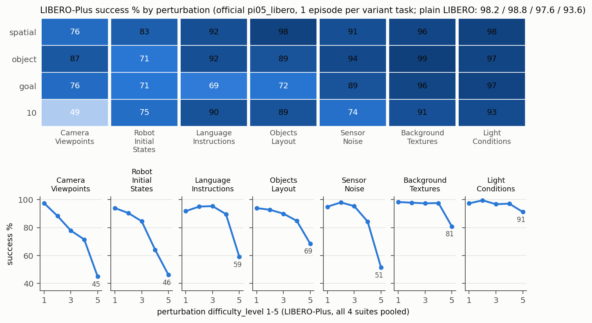

# notes/04 LIBERO-Plus：换个视角、换个起手姿势，它还会吗

> 读者：lwang。目的：原版 LIBERO 的 98% 是"训练和测试同分布"的分数。LIBERO-Plus 把 7 类扰动加在同样的 40 个任务上，每类几百个变体。这份笔记讲扰动是怎么注入的、官方 π0.5 在上面怎么掉、失败长什么样。对应计划 §1.4。数据 `results/libero_plus_by_category.csv`、`_by_difficulty.csv`，图 `results/libero_plus.png`，逐集 `results/libero_plus/<suite>/episodes.csv`。

## 1. 扰动怎么注入（改了 robosuite / LIBERO 的什么）

LIBERO-Plus 是 LIBERO 的 fork（`external/LIBERO-plus/`），协议和原版几乎一样：每个"任务"是一个 BDDL 文件，**每个变体任务只跑 1 集**（`num_trials_per_task=1`），所以 4 个 suite 共 10,030 集。类别和强度等级在 `libero/libero/benchmark/task_classification.json`。七类扰动走两条路：

**(a) 文件名编码，环境构造时解析**（`libero/libero/envs/env_wrapper.py:207-230`）：

```python
if "_view_" in bddl_file_name and "_initstate_" in bddl_file_name:
    bddl_file_name, angle_view_initstate = bddl_file_name.split("_view_")
    angle_view, init_state = angle_view_initstate.split("_initstate_")
    if "_noise_" in init_state:
        init_state, noise = init_state.split("_noise_")
    horizon_view, vertical_view, scale_factor, end_point_rot, end_point_vertical = angle_view.split("_")
    if int(init_state) != 0:
        robots = [robots[0] + str(init_state)]      # "Panda" -> "Panda384"
```

| 类 | 文件名片段 | 实现 |
|---|---|---|
| Camera Viewpoints | `view_H_V_S_0_0` | agentview 相机绕 z 转 H 度、绕 y 转 V 度、距离缩放 S/100（`problems/*.py:_setup_camera`）。wrist 相机不动 |
| Robot Initial States | `initstate_N`（N≠0） | 换一个 `MountedPandaN` 机器人类，只有 `init_qpos` 不同（`envs/robots/*_variants.txt`，500 个预生成的关节初始角） |
| Sensor Noise | `noise_N` | 对 **agentview 图**做图像腐蚀：1–10 运动模糊、11–20 高斯模糊、21–30 变焦模糊、31–40 雾、41–50 玻璃模糊，每 10 一档强度 1–5（`env_wrapper.py:step/reset`）。wrist 图不动 |

**(b) 生成新的 BDDL 文件**（`libero/libero/bddl_files/<suite>/`）：

| 类 | 文件名片段 | 实现 |
|---|---|---|
| Objects Layout | `add_N` / `moved_levelK_sampleM` | 在 BDDL 的 `:regions`/`:objects` 里加一个干扰物（bag_of_yeast 之类），或把原物体的初始区域挪开 |
| Language Instructions | `language_N` | 只改 `(:language ...)`，比如 "Open the top drawer and put the bowl inside" → "When you get a chance would you mind opening the top drawer to store the bowl inside" / "I need the bowl placed inside the top drawer" |
| Background Textures | `table_N` | 换 problem class，桌面/墙贴图换成另一张 |
| Light Conditions | `light_N` | 换 problem class（`..._kitchen_light_sync_modified_N`），场景 xml 的灯光参数不同 |

所以**摄像头、机器人起手姿势、图像噪声三类对策略来说是"视觉输入变了，任务没变"；布局和语言两类是"任务描述或场景内容变了"**；纹理和光照介于其间。

对我们 pipeline 的影响：只需要 `PLUS=1` 切 venv 和 `LIBERO_CONFIG_PATH`（`run_eval.sh`），client 代码一行没改。装环境的坑见 notes/00 报错 5–6。

## 2. 怎么跑

```bash
N=0 sbatch --array=0-3 scripts/eval_plus.sbatch            # 4 个 suite 全量，各 8–12 卡时（A100）
N=0 RESUME=1 sbatch --array=3 scripts/eval_plus.sbatch     # 超时后续跑：跳过 episodes.csv 里已有的任务
python3 scripts/summarize.py --by category results/libero_plus/*/episodes.csv
external/LIBERO-plus/.venv/bin/python scripts/plot_results.py
```

`scripts/plus_select.py` 按类别抽任务索引；`--n 0` 全量，`--exclude-csv` 续跑。libero_10 全量超过 12 小时上限（任务多、每集 520 步），第一次跑到 1750/2519 被杀，剩下的 Objects Layout、Light Conditions 和一部分 Sensor Noise 用 `RESUME=1` 补（作业 1708765，7.6 小时跑完）。四 suite 总计 10,030 集、约 36 卡时。

## 3. 结果

### 3.1 按类别 × suite（每格 250–450 集，CI 约 ±3–5 个点）



| 类 | spatial | object | goal | libero_10 | 四 suite 合并 | 原版 LIBERO |
|---|---|---|---|---|---|---|
| Camera Viewpoints | 76.3 | 86.9 | 76.2 | **48.9** | 71.7 | 98.2 / 98.8 / 97.6 / 93.6 |
| Robot Initial States | 83.1 | 71.1 | 70.7 | 75.1 | 74.7 | |
| Language Instructions | 91.8 | 91.5 | **69.3** | 89.8 | 85.2 | |
| Objects Layout | 97.9 | 89.1 | **71.8** | 89.1 | 86.5 | |
| Sensor Noise | 91.5 | 94.1 | 89.4 | 74.4 | 86.9 | |
| Background Textures | 96.1 | 99.2 | 96.4 | 90.7 | 95.4 | |
| Light Conditions | 97.6 | 96.6 | 97.1 | 93.1 | 96.1 | |
| **全部扰动** | 90.2 | 89.0 | 79.9 | 78.3 | 84.6 | 97.0 |

对照 LIBERO-Plus 论文榜（`external/LIBERO-plus/README.md`）里的 π0（不是 π0.5）：Camera 13.8 / Robot 6.0 / Language 58.8 / Light 85.0 / Background 81.4 / Noise 79.0 / Layout 68.9。**π0.5 全面好于 π0，特别是相机视角（14→72）和机器人初始状态（6→75）**。榜上最好的 OpenVLA-OFT+ 是在 LIBERO-Plus 数据上混合微调过的（Camera 92.8），不可比。

### 3.2 按强度等级（四 suite 合并）

| 等级 | Camera | Robot | Language | Layout | Noise | Background | Light |
|---|---|---|---|---|---|---|---|
| 1 | 97.5 | 94.0 | 91.8 | 94.0 | 94.9 | 98.3 | 97.3 |
| 3 | 77.8 | 84.5 | 95.4 | 90.0 | 95.3 | 97.3 | 96.7 |
| 5 | **45.0** | **46.2** | **59.1** | 68.5 | **51.5** | 80.8 | 91.2 |

三种曲线形状：相机和机器人姿势是**单调往下掉**，等级 2 就开始丢分；语言、布局、噪声是**前四级平、第五级断崖**（噪声 5 级是玻璃模糊，libero_10 上尤其伤）；光照和纹理基本不掉。

### 3.3 失败长什么样

抽了 56 条失败做拼图（`results/failure_gallery/plus/<category>/`，标注 `labels.csv`）：

| 类 | 条数 | A 接近停滞 | D 悬停不放 | E 抓错/放错 | C 放置偏离 | F |
|---|---|---|---|---|---|---|
| Camera Viewpoints（libero_10） | 12 | 6 | 6 | 0 | 0 | 0 |
| Robot Initial States（三 suite） | 24 | 6 | 10 | 5 | 2 | 1 |
| Language Instructions（goal） | 10 | 3 | 1 | **6** | 0 | 0 |
| Objects Layout（goal） | 10 | 3 | 2 | 3 | 2 | 0 |
| 合计 | 56 | 18 | 19 | 14 | 4 | 1 |

三条观察：

1. **视觉类扰动（相机、起手姿势）下的失败和原版一样，是"停住"**：手悬在物体上方不抓，或抓着悬在目标上方不放。12 条相机失败里 0 条抓错物体。策略不是看错了，是在陌生输入下不敢落子。相机转 70 度的书架任务（`t906/t912`）手停在书上方 500 步一动不动。
2. **语言改写下的失败是"去抓碗"**：10 条里 6 条是把目标物换成了碗，比如 "turn on the stove" 的改写版抓起碗举到炉子上方，"put the wine bottle on the rack" 的改写版手悬在碗上方。goal suite 10 个任务里 5 个和碗有关，碗是训练里最常见的目标；指令一变得不熟悉，策略就退回这个先验。这是比"成功率降 28 个点"更具体的信息：**语言 grounding 退化的方向是可预测的，退回训练集的众数物体**。
3. **布局挪动时策略按记忆的位置放**：`put_the_bowl_on_the_plate` 把盘子挪走后，两条失败都是碗被放到了盘子原来的位置（C）。配合 notes/01 §3 "pi05_libero 不读 state"，策略对位置的依赖来自图像记忆而不是感知。

## 4. 这一节回答了什么、没回答什么

回答了：
- 最伤的扰动是相机视角和机器人起手姿势（等级 5 都在 45% 附近），其次语言改写在 goal suite 上和 5 级传感器噪声。光照、纹理几乎免疫。四 suite 合并 84.6%，比原版 LIBERO 的 97.0 低 12 个点；libero_10 和 goal 掉得最多（78–80%）。
- 失败形态和原版一致：视觉扰动→停滞，语言扰动→退回先验物体。没有一种扰动让策略"乱动"。
- π0.5 比论文榜上的 π0 稳得多，相机视角从 14% 到 72%。

没回答、第 2 周可以接的：
- LIBERO-Plus 每个变体只跑 1 集。配合 notes/03 §2.3 的结论（失败主要是采样随机），同一个变体任务重复几次成功率会不会回升？可以挑相机等级 5 的 20 个变体各跑 5 次。
- 机器人起手姿势扰动为什么伤这么大：pi05_libero 不读 state，只能从图像里看手臂。起手姿势变了，第一帧的手臂图像就在训练分布外。第 2 周微调时加 `discrete_state_input` 做一次对比是便宜的实验。

## 5. 换数据源 / 真机时这里会踩什么

- 真机上相机位置差几厘米、机械臂起手姿势随机，正好是这里最伤的两类。LIBERO 原版 98% 对真机没有预测力，LIBERO-Plus 的 Camera/Robot 列才有。
- `task_classification.json` 的 `difficulty_level` 是作者标的，不同类别之间的"5 级"不可比。
- 每个变体 1 集，类别级 CI ±3–5 个点；类别 × suite 级 ±5–8。不要比单个任务。
